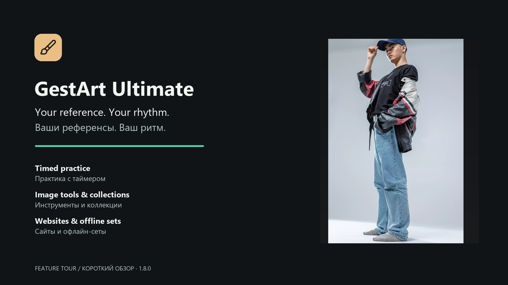
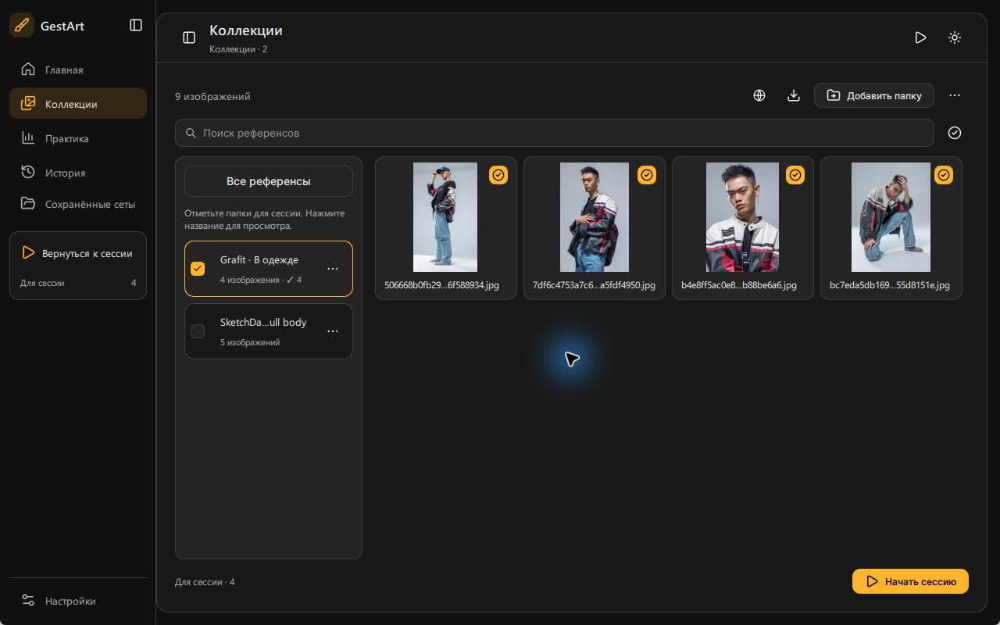
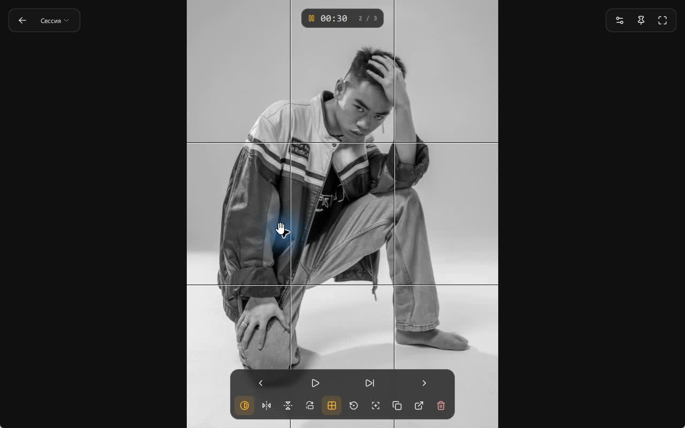
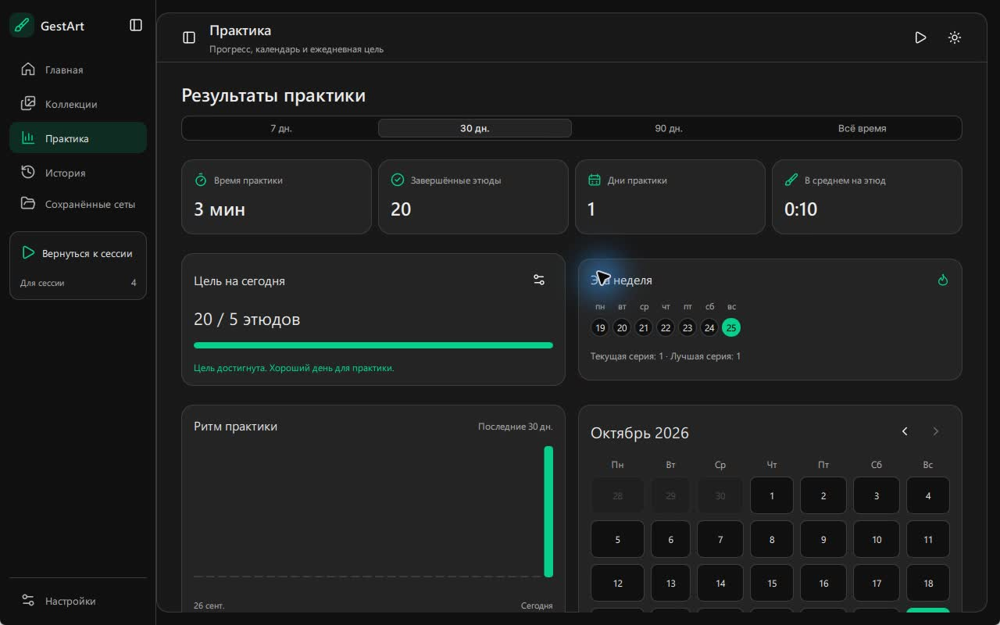
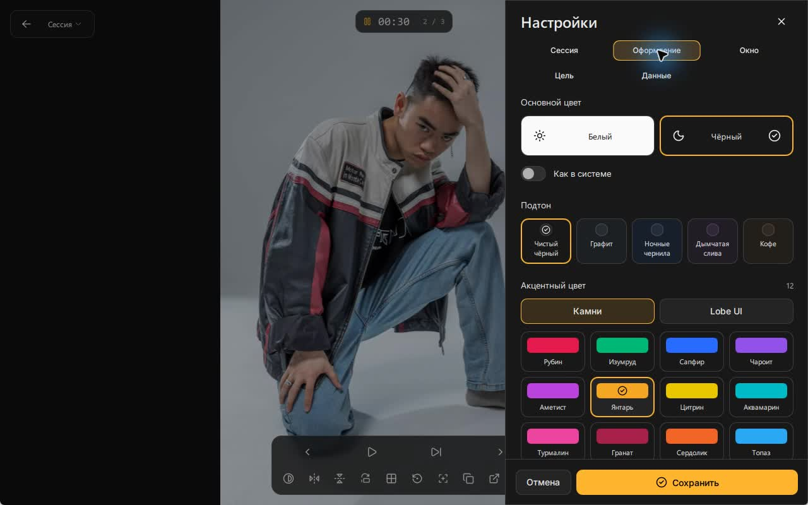
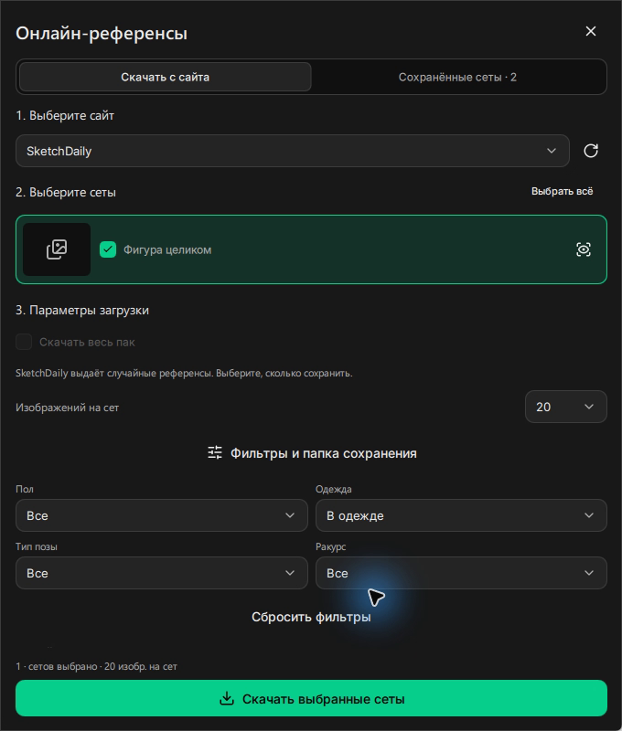
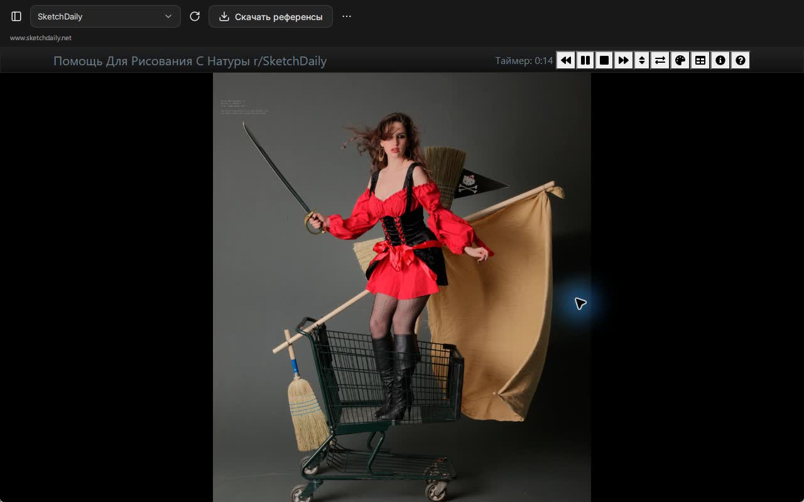

# GestArt Ultimate 1.8.0

[English](README.md) · [Русский](README.ru.md)

GestArt Ultimate — настольная программа для художников: выбирайте референсы,
задавайте время на рисунок и практикуйтесь с таймером. Работайте со своими
изображениями или скачивайте сеты с Quickposes, Proko, Pose Library и SketchDaily.
Сохранённые изображения доступны без интернета и аккаунта GestArt.

Ветка **ultimate** содержит версию на C++20 и Qt Quick.
Прежняя версия проекта сохранена в [ветке old](https://github.com/LeonWGal/GestArt/tree/old).

## Посмотрите короткий обзор

[▶ Смотреть или скачать видео — 1:27, Full HD, MP4](https://github.com/LeonWGal/GestArt/releases/download/ultimate-v1.8.0/GestArt-Ultimate-Highlights-RU-EN.mp4).
Надписи на английском и русском, без озвучки. В ролике используются референсы
в одежде из Grafit Reference Sampler; также показаны практика на сайте и скачивание.
Музыка: **Lofi Hip Hop Loop** от OMF-Games под CC0;
см. [источник и лицензию музыки](assets/media/music-license.txt).

## Возможности

Выбирайте инструменты под свою практику рисунка:

| Возможность | Что можно делать |
| --- | --- |
| Практика с таймером | Задавайте время на референс и число этюдов, занимайтесь без ограничений, ставьте паузу, пропускайте кадры и включайте перерывы со звуковым отсчётом. |
| Инструменты изображения | Включайте чёрно-белый режим и настраиваемую сетку, отражайте и поворачивайте референс, приближайте детали, перемещайте и вписывайте изображение в окно. |
| Коллекции | Добавляйте свои папки, смотрите превью, ищите изображения, переименовывайте коллекции и выбирайте состав сессии. |
| Четыре онлайн-источника | Открывайте Quickposes, Proko, Pose Library и SketchDaily внутри программы с настройками и таймером самого сайта. |
| Скачивание сетов | Смотрите превью сетов, применяйте доступные фильтры, выбирайте число изображений или весь пак и продолжайте прерванные загрузки. |
| Офлайн-практика | Храните скачанные сеты на диске и запускайте только выбранный сет с таймером и инструментами GestArt. |
| Фокус и управление окном | Скрывайте панели при уходе курсора, включайте полный экран или режим поверх окон, настраивайте видимость и положение таймера. |
| Оформление | Выбирайте светлую или тёмную тему либо оформление системы, меняйте цветовые акценты, прозрачность и размытие панелей, уменьшайте анимацию. |
| Учёт практики | Смотрите историю, завершённые этюды, время занятий, активные дни и календарь; задавайте цели по времени или числу этюдов. |
| 22 языка интерфейса | Меняйте язык в **Настройки → Оформление**; для арабского доступен интерфейс справа налево. |
| Portable-сборки Windows | Запускайте EXE или ZIP без установки, храните настройки, историю и загрузки в папке данных portable-версии. |

Все 22 языка интерфейса

Английский, арабский, венгерский, вьетнамский, индонезийский, испанский,
итальянский, китайский (упрощённый), китайский (традиционный), корейский,
немецкий, нидерландский, польский, португальский (Бразилия), румынский,
русский, тайский, турецкий, украинский, французский, чешский и японский.

Часть переводов выполнена машинно. Для отсутствующих переводов используется английский.

## Скриншоты

На скриншотах показаны русский интерфейс и референсы Grafit в одежде.
Язык интерфейса можно изменить в программе.

| Коллекции и превью | Инструменты в сессии |
| --- | --- |
|  |  |

| Календарь практики и цели на день | Темы и настройки оформления |
| --- | --- |
|  |  |

## Что изменилось после GestArt 0.9.8

Ultimate продолжает программу для практики рисунка. Таймер, перерывы, сетка,
эффекты и работа со своими изображениями остаются основой сессии.
Основные отличия от версии 0.9.8:

| Возможность | GestArt 0.9.8 | GestArt Ultimate 1.8.0 |
| --- | --- | --- |
| Основа приложения | Python и PyQt6 | C++20 и Qt Quick |
| Источники референсов | Локальные папки | Локальные папки и скачивание с Quickposes, Proko, Pose Library и SketchDaily |
| Организация | Просмотр папок и статистика по папкам | Библиотека коллекций, превью и сохранённые сеты для отдельных сессий |
| Сайты | Референсы добавляются из папок | Встроенный браузер, выбор сетов, полные паки и продолжение загрузок |
| Практика | История просмотров и статистика папок | История сессий, календарь практики и цели на день |

В версии 0.9.8 заявлены 100 языков; интерфейс Ultimate содержит 22 языковых
каталога. Часть переводов Ultimate выполнена машинно, отсутствующие строки
отображаются на английском.

## Скачайте и запустите

Готовые сборки предназначены для **Windows 10 (1809+) / Windows 11 x64**:

| Файл | Как запустить |
| --- | --- |
| [Portable EXE](https://github.com/LeonWGal/GestArt/releases/download/ultimate-v1.8.0/GestArt-Ultimate-1.8.0-windows-x64-portable.exe) | Сохраните в доступную для записи папку и откройте. Установка не нужна. |
| [Portable ZIP](https://github.com/LeonWGal/GestArt/releases/download/ultimate-v1.8.0/GestArt-Ultimate-1.8.0-windows-x64-portable.zip) | Распакуйте архив целиком и откройте `Start.cmd`. |
| [SHA-256](https://github.com/LeonWGal/GestArt/releases/download/ultimate-v1.8.0/SHA256SUMS.txt) | Сверьте контрольную сумму выбранного файла. |

Portable EXE включает программу и библиотеки. При первом запуске он
распаковывает библиотеки в локальный кэш. Для этого запуска требуется
.NET Framework 4.8 или новее. ZIP запускает приложение напрямую и не требует
.NET. Python, Qt SDK и права администратора для готовой сборки не нужны.

EXE хранит настройки, историю и загрузки в `GestArtUltimate-data` рядом с собой.
ZIP хранит их в `data` внутри распакованной папки. Не переносите один файл
`bin/GestArtUltimate.exe` отдельно от библиотек.
Подробнее см. [запуск portable-версии](docs/portable.md).

## Начните со своих изображений

1. На главной нажмите **Добавить папку** и выберите изображения.
2. Укажите время на референс и количество рисунков.
3. Нажмите **Начать сессию**.

Таймер начинается после отображения изображения. Пробел ставит сессию на
паузу, стрелки переключают референсы. При уходе курсора панели скрываются;
таймер и прогресс следуют настройкам окна.

## Скачайте сет с сайта

1. Нажмите **Скачать референсы**.
2. Во вкладке **Скачать с сайта** выберите сайт и отметьте сеты.
3. Выберите количество изображений или включите **Скачать весь пак**.
4. При необходимости откройте **Фильтры и папка сохранения**.
5. Нажмите **Скачать выбранные сеты** или **Скачать весь пак**.
6. Во вкладке **Сохранённые сеты** нажмите **Настроить сессию**.
7. Задайте таймер и нажмите **Начать сессию**.

В сессию попадает только выбранный сет. Список сохраняется после перезапуска.
Прерванную загрузку можно продолжить. Для одного сета доступен флажок
**Сразу начать сессию после скачивания**.

Полный пак доступен для Quickposes, Proko и Pose Library. SketchDaily выдаёт
случайные референсы: для него выберите количество изображений. Загрузчик
использует открытые сеты; для аккаунта и закрытых материалов откройте сайт.

| Фильтры загрузки | Сохранённые сеты |
| --- | --- |
|  |  |

## Откройте сайт внутри программы

На странице **Онлайн-просмотр** выберите сайт. Его настройки и таймер
работают во встроенном браузере. При уходе курсора верхняя панель полностью
убирается, освобождая место изображению. Возвращение курсора возвращает
управление. Кнопка **Скачать референсы** открывает загрузку выбранного сайта.

Для практики с таймером, сеткой, отражением и статистикой GestArt скачайте сет
и запустите его через **Сохранённые сеты**.

## Используйте инструменты сессии

Основные команды доступны с клавиатуры:

| Действие | Клавиши |
| --- | --- |
| Пауза / продолжить | Пробел |
| Предыдущий / следующий референс | ← / → |
| Пропустить без отметки завершения | S |
| Чёрно-белый режим | B |
| Отразить по горизонтали / вертикали | H / V |
| Повернуть на 90° | R |
| Сетка | G |
| Сбросить эффекты | Backspace |
| Вписать / масштаб 100% | Ctrl+0 / Ctrl+1 |
| Полный экран | F11 |
| Настройки | Ctrl+, |
| Поверх остальных окон | A |

В приложении доступны коллекции, предпросмотр, история, календарь практики,
цели на день, перерывы и звуковой отсчёт. Минимальный размер окна — 360×440.
Windows-сборка читает JPEG, PNG, BMP, GIF, WebP, TIFF, ICO, SVG и HEIC/HEIF с HEVC.
GIF отображается статично; AVIF зависит от доступного декодера.

Интерфейс поддерживает 22 языка. Часть переводов выполнена машинно;
для непереведённых строк используется английский текст.

## Найдите инструкции

- [Сайты, скачивание и сохранённые сеты](docs/online-sources.md).
- [Portable-версия, данные и обновление](docs/portable.md).
- [Сессия, панели и управление](docs/interface.md).
- [Сборка из исходников](docs/build.md).
- [История изменений](CHANGELOG.md).
- [Архитектура](docs/architecture.md).
- [Как внести изменения](CONTRIBUTING.md).

## Лицензии

Код приложения распространяется под [MIT](LICENSE).
Библиотеки и шрифты сохраняют свои лицензии; см.
[сторонние компоненты](THIRD_PARTY_NOTICES.md) и [исходники библиотек](licenses/SOURCES.md).
Скачанные референсы принадлежат их авторам; сведения об источнике хранятся
в `sources.json` рядом с изображениями.
