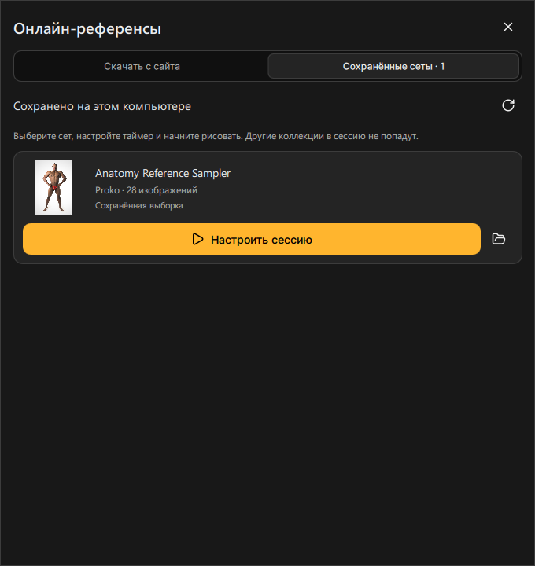

# Скачайте референсы и начните сессию

Эта инструкция помогает выбрать сайт, сохранить изображения и запустить
практику с таймером GestArt. Интернет нужен для просмотра сайта и скачивания;
сохранённые сеты доступны офлайн.

## Выберите источник

Откройте **Скачать референсы** на главной или на карточке сайта.
Во вкладке **Скачать с сайта** выберите источник:

| Сайт | Доступные референсы | Полный пак |
| --- | --- | --- |
| [Quickposes](https://quickposes.com/en/gestures/timed) | Фигура, лица, кисти, ступни, животные, пейзажи, город | Да, с учётом фильтров |
| [Proko](https://www.proko.com/timer) | Бесплатные паки гостевой сессии | Да, со всех страниц пака |
| [Pose Library](https://poselibrary.com/) | Открытые бесплатные галереи SFW/NSFW | Да |
| [SketchDaily](https://www.sketchdaily.net/en) | Случайные изображения фигуры | Выберите количество |

Загрузчик не использует вход в аккаунт встроенного браузера.
Для материалов, требующих аккаунта или покупки, используйте режим сайта.

## Сохраните изображения

1. Отметьте один или несколько сетов. Значок предпросмотра открывает обложку
   или пробное изображение. Для длинного списка используйте поиск.
2. Выберите количество изображений на сет или включите **Скачать весь пак**.
3. При необходимости откройте **Фильтры и папка сохранения**.
4. Нажмите основную кнопку скачивания.

Quickposes поддерживает пол и одежду: одежда применяется к фигуре и ступням,
пол — к людям. Неприменимые фильтры отключены. SketchDaily поддерживает пол,
одежду, тип позы и ракурс. У Proko и Pose Library выбирайте подходящий сет.

Каждый сет сохраняется в отдельную папку. Папка сохранения запоминается.
В одном запуске доступны до 20 сетов; выборки ограничены 500 изображениями
суммарно. Режим полного пака не обрезает пак до 100 или 500 изображений.

Прогресс и **Остановить загрузку** остаются видны при прокрутке. Панель можно
закрыть — скачивание продолжается в фоне. Остановка сохраняет готовые файлы.
После завершения открывается вкладка **Сохранённые сеты**.

## Запустите только сохранённый сет

1. Откройте **Сохранённые сеты** на главной, в боковой панели или во вкладках
   окна онлайн-референсов.
2. У нужного сета нажмите **Настроить сессию**.
3. Выберите время на изображение и количество рисунков.
4. Нажмите **Начать сессию**.

Другие коллекции в эту сессию не включаются. Повторное скачивание не нужно.
Завершите активную сессию перед запуском другой.

Для одного выбранного сета можно включить
**Сразу начать сессию после скачивания**. Применяются сохранённые настройки
таймера GestArt.

## Продолжите прерванную загрузку

Откройте **Сохранённые сеты** и нажмите **Продолжить загрузку** у частично
скачанного сета. Программа сохраняет исходные фильтры и папку назначения,
даже если после остановки вы выбрали другую папку по умолчанию.
Уже скачанные изображения используются повторно.

Список хранится в `download-library.json` внутри профиля. При запуске
программа также находит сеты предыдущей версии в стандартной и выбранной
папках загрузки. Если папка удалена или перемещена, карточка сообщает об этом.

## Работайте во встроенном браузере

На странице **Онлайн-просмотр** откройте сайт. Верхняя панель содержит выбор
сайта, обновление, скачивание и меню. В узком окне команды доступны в меню.
F11 переключает полный экран; сочетания инструментов GestArt отключены,
пока открыт сайт.

При уходе курсора панель и занимаемое ею место убираются. Если на странице
есть подходящее видимое изображение, оно показывается без элементов сайта.
При возвращении курсора сайт восстанавливается. Настройки и таймер сайта
продолжают работать. Профиль браузера хранится в `browser` внутри профиля
GestArt; при уходе со страницы звук сайта отключается.

## Проверьте результат

В карточке сета видны источник и количество сохранённых изображений.
Кнопка папки открывает файлы в проводнике. Рядом с изображениями находится
`sources.json` с доступными сведениями об источнике и авторе.

После запуска сета убедитесь, что отображается его изображение и идёт таймер.
Для резервной копии и переноса профиля см. [данные portable-версии](portable.md).
Публичные ответы сайтов могут изменяться; если загрузка недоступна,
обновите список источника или откройте сайт.
